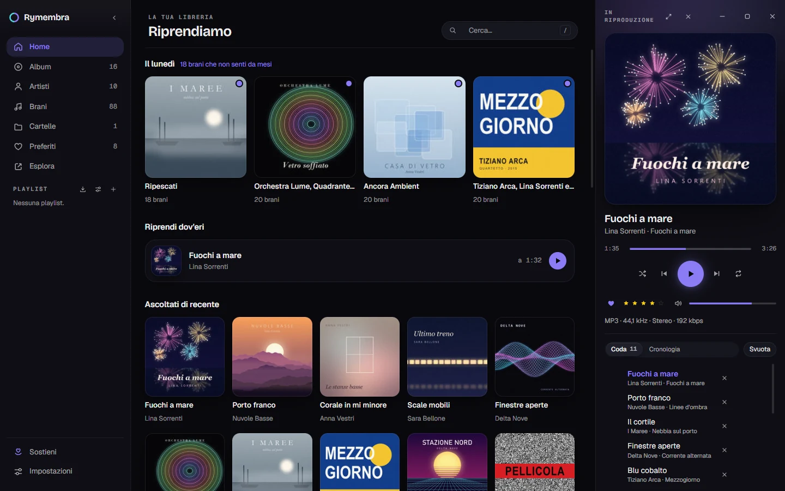
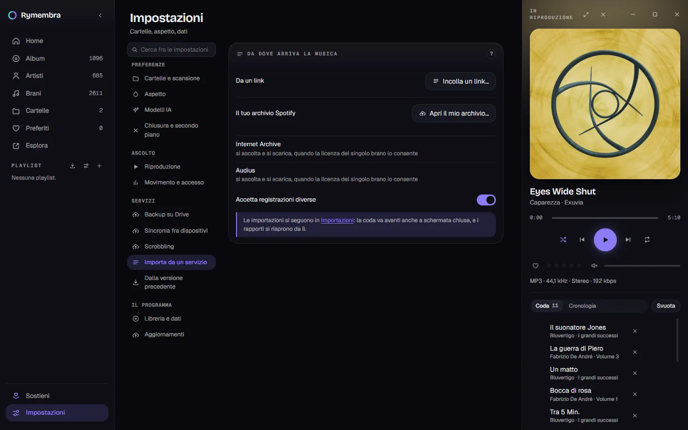
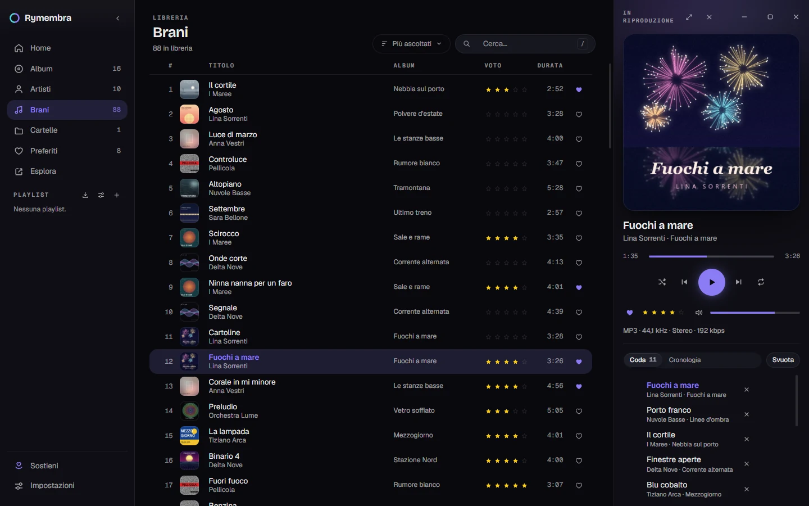
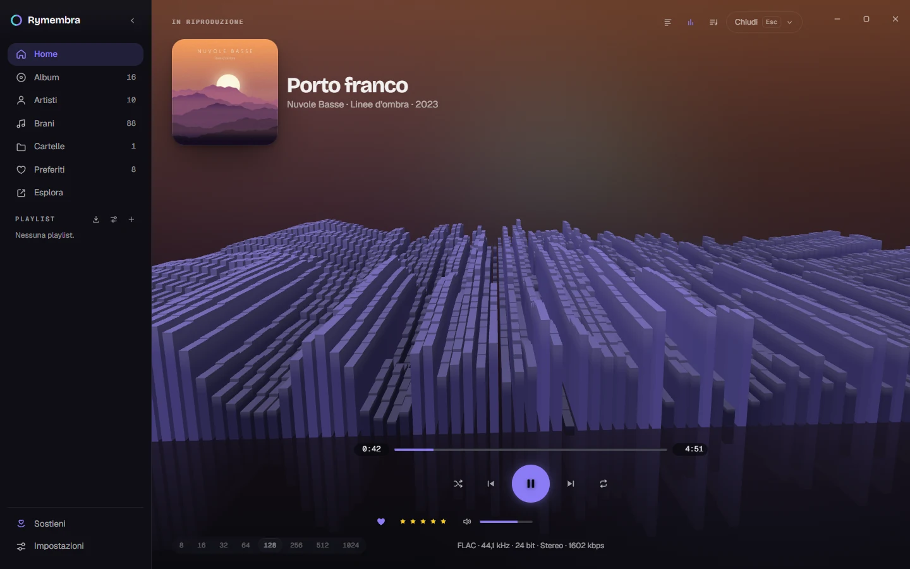
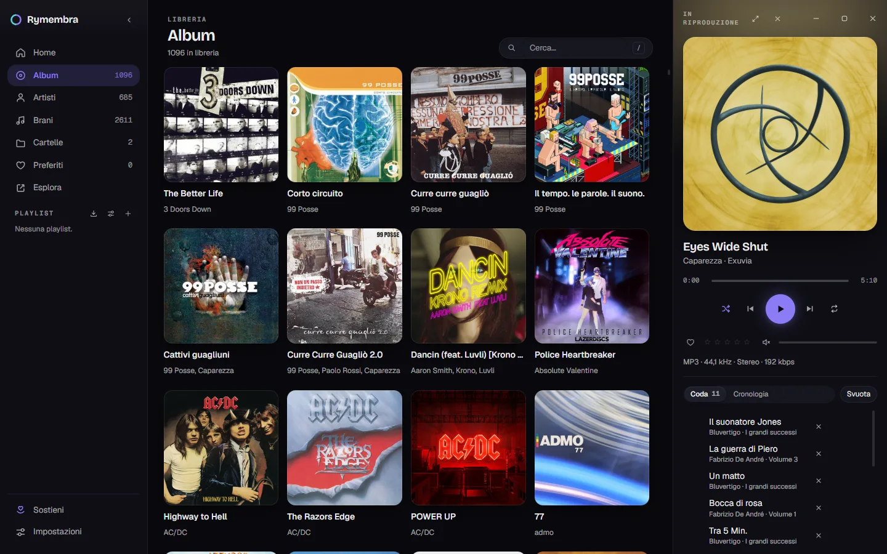
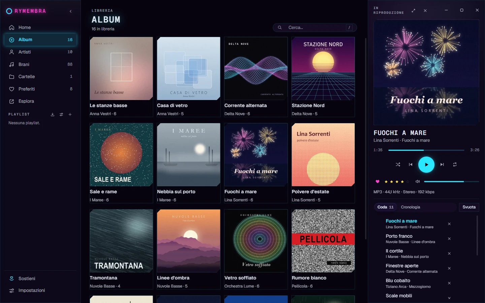
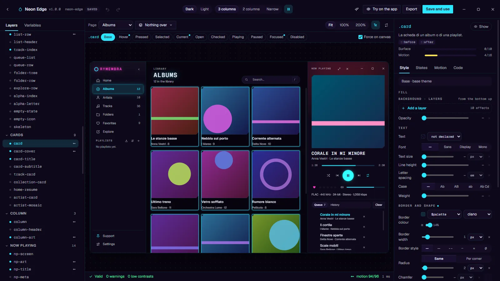

# Rymembra

A music player for Windows, written in Rust. It plays the audio files on your
disk and joins your local library up with the freely accessible music catalogs.

> **Project status:** under development. It builds and runs on Windows. The
> executable is not digitally signed, and the macOS, Linux and mobile versions
> do not exist. See [Known limits and planned
> work](#known-limits-and-planned-work).

## Contents

- [Overview](#overview)
- [Where the music comes from](#where-the-music-comes-from)
- [Sources that are excluded](#sources-that-are-excluded)
- [Features](#features)
- [Interface](#interface)
- [Customization](#customization)
- [Installation](#installation)
- [Building](#building)
- [Architecture](#architecture)
- [Licenses](#licenses)
- [Privacy](#privacy)
- [Keeping the project going](#keeping-the-project-going)
- [Known limits and planned work](#known-limits-and-planned-work)
- [Related documents](#related-documents)

---

## Overview

Rymembra plays the audio files already on your disk. Starting from a playlist —
exported from your Spotify archive, read from an M3U file, or given as a link —
it matches the tracks against your local library and fetches the missing ones
from the freely accessible catalogs: Internet Archive and Audius. Since 2.4.0
those catalogs can also be searched directly, a phrase at a time, from
**Explore** — and a track found there can be listened to without ever being
written to disk. Every track it acquires keeps the license of the source it
came from. Tracks that no free catalog has end up in a shopping list, with
links to the shops that pay the artists.

The program does not download content from YouTube, does not scrape Spotify and
does not ship third-party binaries. The reasons are documented in [Sources that
are excluded](#sources-that-are-excluded) and are a project constraint, not a
temporary limitation.



The home screen. At the top, «Il lunedì» (*Monday*): this week's collections,
twenty tracks each, worked out on this computer; the dot marks the ones that are
new. Below, «Riprendi dov'eri» (*Resume*) brings back the last interrupted track
at the exact point where it stopped — here *Eyes Wide Shut*, at 3:25 — and one
click plays it from there. Then «Ascoltati di recente» (*Recently played*);
further down the page, out of the picture, the most recently added albums and
the records you haven't played in a while.

On the left, the destinations with their counts — «Cartelle» (*Folders*) counts
the watched folders, not the tracks, and «Esplora» (*Explore*) has no count at
all — and, under «Playlist», the buttons to import a playlist from a file, to
create a smart one and to create an empty one. On the right, the column of what
is playing: cover, title, progress, controls, rating, volume and the line that
says what the file is, with the queue underneath («Coda», 11 tracks here), the
history («Cronologia») and the button that empties the queue («Svuota»). The
same column comes back in most of the pictures that follow.

*The images in this document show the Italian interface — the program speaks
English too, and the Studio picture is taken in English — and come from a real
library of 2611 tracks, 1096 albums and 685 artists.*

---

## Where the music comes from

| Source | Content | Local copy |
| --- | --- | --- |
| **Local files** | The main library. Scanning of the folders you point at. | Already yours |
| **Internet Archive** | Live Music Archive (over 250,000 concerts by artists who authorized the recording), netlabels, public domain | Yes, when the item's license allows it |
| **Audius** | Tracks published by artists under an open license | Yes, when the artist has enabled downloading **and** the license allows it |
| **Spotify GDPR archive** | Playlists, saved tracks and albums, followed artists, complete listening history | Metadata, not audio |
| **Playlist files** | M3U, M3U8, PLS | The path, not the file |
| **MusicBrainz + Cover Art Archive** | Tags and cover art | Free metadata |

On Audius, permission is set by the artist per individual track. There are three
distinct controls: the download switch and two *gates*, which can make access
conditional on following the artist or on holding a token. Rymembra checks all
three and considers permission granted only in the absence of any prohibition.

**Jamendo** is implemented and covered by tests, but disabled in this version.
The cause isn't technical: the API is free for non-commercial use only, and the
terms define commercial use as «any monetary compensation». The module is
already set up for streaming-only listening — the terms forbid caching and
offline access — through `rymembra-net::FlussoHttp`, which plays a track without
writing it to disk. See [Known limits](#known-limits-and-planned-work).



The same sources in the program, under *Settings → Services → Import from a
service* («Servizi → Importa da un servizio»). The «?» in the corner of the card
opens the guide to the section, closed in the picture. What the rows do:

- **«Da un link»** (*From a link*) takes a track, an album or a collection from
  archive.org or audius.co, with no account and no API key. Rymembra reads what
  is inside, looks in the library for what you already have, and fetches the
  rest when the license allows it.
- **«Il tuo archivio Spotify»** (*Your Spotify archive*) reads, on this
  computer, the ZIP that Spotify hands you on request: playlists, liked tracks,
  saved albums and artists, and years of listening, all at once instead of
  thirty pasted links.
- **Internet Archive** and **Audius** are listed with the rule they follow: a
  track is streamed and downloaded only when its own license allows it.
- **«Accetta registrazioni diverse»** (*Accept different recordings*) lets a
  concert, a reissue or a re-recording stand in for the studio version, since
  the free catalogs are mostly made of those. When one is taken, the track
  says so with a «dal vivo» (*live*) badge. With the switch off, the search is
  strict and finds much less.

The imports themselves run in the «Importazioni» (*Imports*) page: the queue
goes on with the screen closed, and the reports can be opened again from
there.

### What it doesn't cover

No freely accessible source distributes the commercial catalog. This is not a
technical limitation to be worked around: it is the reason other programs carry
out operations the terms of the services they use do not permit. Rymembra covers
what it can through lawful channels and, for the rest of the catalog, points at
where to buy it. Anyone looking for a tool to obtain commercial discographies
for free will not find that feature in Rymembra.

---

## Sources that are excluded

### YouTube

The *YouTube API Developer Policies* forbid downloading and storing audiovisual
content (§ III.E.1.a: «You must not… download, import, backup, cache, or store
copies of YouTube audiovisual content without YouTube's prior written
approval»). There is no configuration that would make the operation compliant.

The same policies also forbid separating the audio from the video (§ III.I.7),
playback from a player that isn't visible (§ III.I.9) and retaining metadata for
more than thirty days (§ III.E.4). A music player that keeps a persistent
library is incompatible with all three clauses. The source is therefore excluded
entirely, and not in a reduced form.

### Unauthorized access to Spotify

Using Spotify's private endpoints, reconstructed tokens or the web player's
client id constitutes unauthorized access to the service and is excluded.

What remains available is the GDPR archive, which Spotify is required to hand to
the user on request under art. 20 of EU Regulation 2016/679, and which contains
a longer listening history than the public API offers.

---

## Features

- **Every track at the same loudness.** Rymembra measures each file with EBU
  R128 — integrated loudness and true peak — in a background pass that runs
  only while nothing is playing, and uses ReplayGain or R128 tags where the
  file has them. Track, album or automatic mode; a track is never raised past
  its own peak, and a soft limiter catches the rest. The volume slider follows
  a perceptual curve.
- **Gapless playback**, gapless across sample rates too (a 44.1 kHz album on a
  48 kHz output joins without a click), with an equalizer, crossfade and a
  persistent queue. A single audio engine (`cpal` + `symphonia`) spread over
  three threads, with no shared lock at all between the decoder and the audio
  callback; the stream sleeps after thirty seconds of silence, so the PC can
  go to sleep with Rymembra open.
- **What the file really is.** Next to the rating, a line says what is
  playing — «FLAC · 44.1 kHz · 24-bit · Stereo · 1058 kbps» — as the
  **decoder** reports it while the track plays: the real codec inside an
  `.m4a`, the MP3 that a FLAC page of the Internet Archive actually streams.
  It describes the edition and not the output; if the sound card is
  resampling, the line still says 44.1 kHz, and hovering it says «Resampled
  from 44.1 kHz to 48 kHz for the audio output».
- **A library on SQLite**: incremental scanning with detection of moved files,
  manual and automatic playlists, ratings, favorites and listening history. A
  track can leave it too: «Remove from library» takes the row out and leaves
  the file where it is, «Delete from disk» sends the file to the Recycle Bin —
  or, on a network share, where there is no Recycle Bin, asks you to confirm a
  permanent deletion — and both ask first. A correction you made by hand
  survives its track disappearing and coming back, and so do its plays,
  rating, heart and playlist places, for ninety days.
- **Music on a NAS or a mapped drive.** A folder the share would not list for
  a moment makes its tracks *unverified*, never *gone*; a scan that would
  remove many tracks shows them and asks first; a drive letter and its
  `\\server\share` path are recognised as the same place.
- **Metadata enrichment** from MusicBrainz, written **into the library and
  never into your files**. The search is carried out on the complete album
  rather than on the individual track; in the absence of matches that are
  reliable enough, nothing is written at all. What it works out is annotated in
  a table of its own, so a correction you made by hand always wins over it and
  forgetting the whole thing is one button — see
  [`PRIVACY.md`](PRIVACY.md) § 8. Tags an older version already wrote into your
  files are left alone rather than reverted on your behalf; the way back is a
  separate button of its own, labelled with the fact that it writes into the
  files, and it is kept for one release and then removed.
- **Folders the way foobar2000 shows them**: a tree read out of the library
  instead of the disk — so it opens instantly and never touches a network
  share — with files as leaves in natural order, a panel with the tracks of
  the folder under the cursor (with or without its subfolders), a filter over
  the whole tree, and multiple selection to play, queue, drag onto the queue
  or add to a playlist.
- **Folders that watch themselves.** An album copied into a music folder,
  renamed or deleted there enters or leaves the library a few seconds later,
  without a scan: only the folders that changed are looked at again, and a
  change that would remove too many tracks at once removes nothing. Network
  shares, where Windows does not always tell, can be checked every five
  minutes instead (off by default: it keeps a NAS awake).
- **Explore**: a free-text search across the Internet Archive and Audius, from
  which a track can be listened to without ever being written to disk. A track
  kept this way lives in the library like any other — it is searchable, it sits
  under its album and its artist, it can be queued, rated and favourited — and
  carries the license it was published under and a link to its public page.
  The search runs when you press Enter, not on every keystroke: on the other
  side are public archives that host the project for free.
- **Synced lyrics** from LRCLIB, with no key and no account, and a way to time
  them yourself when nobody has: you tap once per line, and then — optionally —
  once per word, which writes an `.a2.lrc` beside the ordinary `.lrc` that
  every other player can still read. A constant drift is corrected with two
  buttons that are **always** reachable, not only when the fit is judged poor:
  a text that sits inside the right duration can still be half a second early.
  When the catalogue holds more than one answer, «Other lyrics» lists them all
  with their first lines, and what you choose stays chosen — «none of these»
  included, which is remembered rather than asked again.
- **Affinity**: what plays after a record ends is chosen from three independent
  layers — the sound of your files, analyzed locally; what you have listened to;
  and the cultural proximity read from ListenBrainz. Each missing layer removes
  itself without breaking the others, and underneath everything the old rule
  cascade remains as a floor. The queue says which layer chose each track.
- **Monday**: up to four collections of twenty tracks, computed locally while
  the machine is idle, which stay put for seven days and then become other ones.
  What came out last week does not come out again.
- **Skins** that can repaint and animate any part of the window, with a
  built-in visual editor (the Studio) and a packaged distribution format.
  Inside the Studio, a side chat can ask a language model to make the change
  for you — a model running on your own machine (Ollama, or LM Studio's local
  server, the one the Bionic app sits on) or a remote one through OpenRouter.
  It is off until you configure a provider, and what it sends is documented in
  [`PRIVACY.md`](PRIVACY.md) § 2-quater.
- **Backup and synchronization** to Google Drive or to a shared folder, plus a
  **profile** you can carry by hand: a `.ryprofile` archive with the settings,
  the library, the listening history, the lyrics, your corrections, the covers
  and the skin packages in it. It is written and read straight onto the disk,
  one entry at a time, so a profile of several hundred megabytes never sits in
  memory; importing shows you the plan first and proposes a remapping for every
  root that does not exist on this machine. The old seventeen-line JSON is
  still read, and no longer written. Profiles and skin packages written by the
  previous version can still be imported.

  **Google Drive needs a Google project of your own, and the installer
  published here ships without one — on purpose.** A desktop program cannot
  keep an OAuth client secret: anything compiled into the executable can be
  read out of it, and a shared client would put every user's backups on one
  quota that anybody could exhaust. So *Settings → Backup* says «not
  configured» and explains how to turn it on: create an OAuth client of the
  «Desktop app» type in the Google Cloud Console and paste its ID and secret.
  The folder Rymembra writes to is its private application folder, visible only
  to that client. If you would rather not, synchronizing through a shared
  folder (Syncthing, OneDrive, Dropbox) needs no account, and an exported
  profile keeps a copy of everything. Builds made with
  `RYMEMBRA_GOOGLE_CLIENT_ID` and `RYMEMBRA_GOOGLE_CLIENT_SECRET` in the
  environment carry their own client and skip this step. Backup and sync files
  that the previous version left in that folder are recognised and renamed in
  place at the next pass, without uploading them again.
- **Scrobbling** to Last.fm and ListenBrainz.
- **Automatic updates**: a check for releases on GitHub at every start, ten
  seconds after the window is ready, then every thirty minutes; without a
  network it tries again after one, five and fifteen minutes. Installing always
  requires an explicit confirmation, and the installer's signature — bound to
  the version it announces — is verified before it runs. The feature can be
  switched off in the settings; the traffic it generates is documented in
  [`PRIVACY.md`](PRIVACY.md) § 6.

---

## Interface

On first run a guided tour runs once, in fourteen steps — the context menu of a
track, the Folders view and the keyboard shortcuts among them. It is not a
carousel of pictures: each step finds the real element in the window, cuts a
hole in the veil over it and puts the bubble beside it, so what you are shown
is the program at the size and in the skin you are running it in. To show the
player it puts something in the queue, and when it ends the view and the queue
are put back as they were. A step whose element is not there is skipped rather
than faked. *Settings → Redo the tour* brings it back.



The track list, «Brani» (*Tracks*): cover, title and artists, album, rating,
duration and the heart of the favorites, here in «Per scaffale» order (*Shelf
order*), with the search field beside it — `/` or `Ctrl+F` jumps to it. There
are no pages, numbered or endless: the scrollbar is as long as the whole list
from the first moment, only the rows on screen are fetched — dragging to the
bottom of fifty thousand tracks asks for the last rows and nothing in between —
and a view you leave keeps its scroll position, focus and selection for when you
come back. «Select all» selects the whole view, not what happens to be loaded.



The playback screen, «In riproduzione» (*Now playing*), with the spectrum scene
on — here *Skirmish*, from the soundtrack of *S.T.A.L.K.E.R. 2*. The scene is a
grid of bars: from 8 to 1024 across — the row of numbers at the bottom left
chooses how many, 128 here — and about fifty rows in depth. The front row is
now; the rows behind are the last half minute of music, moving back toward the
horizon and fading, with the reflection underneath. The camera sways with the
energy of the low bands, so when the music stops it stops too.

The samples are taken after the equalizer and before the volume control:
changes to the equalization curve are visible in the bars, changes to the
volume are not. The bands reach the interface through a ring buffer that
discards excess samples when it is full, so as not to introduce any wait in
the audio callback. At the bottom right, the line that says what the file is:
«FLAC · 48 kHz · 24 bit · Stereo · 1314 kbps». The three buttons at the top
right switch the lyrics, the spectrum and the queue on and off; «Chiudi»
(*Close*), or Esc, closes the screen.

The whole window zooms, `Ctrl++`, `Ctrl+-` and `Ctrl+0`, over the same seven
steps between 90% and 200% that every browser offers. It is the WebView's zoom
and not a scale in the stylesheet, so the two places that measure the DOM — the
virtualized list and the tour's spotlight — go on working in CSS pixels and
never notice. The step is remembered; it does not travel in a profile, because
it is the correction left over after Windows' own scaling on this monitor.

---

## Customization

| «Plain» skin, the default | «Neon» skin, built in |
| --- | --- |
|  |  |

The same album grid with two of the skins that come with the program. «Plain»
lays the covers on near black with a single violet accent; «Neon» turns the
accent cyan and makes the current entry glow, writes the name in magenta and the
titles in spaced capitals, and squares the cards off with a thin border. Only
the skin changes between the two pictures: the library, the layout and the track
in the column are the same.

A skin redefines colors, borders, shadows, type and corner radii across 101
interface components — and, since 2.3.0, the visualizer's scene as well: not
only its colors, but its geometry and its behavior, from the depth of the room
and the aperture of the lens down to how fast a bar falls. This is not a matter
of switching between a light theme and a dark one — although a skin has both: it
declares its base scheme, dark or light, and a variant for the other one that
may override its tokens, palette, patterns and components. A skin can also ship
its own fonts and images.

Since 3.0 a skin can **animate any component**. A component binds named
animations to fifteen triggers: its ten states — hover, pressed, selected,
current, open, checked, playing, paused, focus, disabled — and five moments
that are not states: entering, leaving, flying from one screen to the next,
being scrolled into view, changing content. Keyframes move, scale, rotate,
skew, blur, recolor and clip. The line that decides what belongs there is that
a skin animates **states of the DOM, not events of the application**. An
endless loop is allowed only on a state — a record turning while music plays —
because the compiler writes the rules that stop it under «reduced motion» for
every animation it emits, and a skin cannot opt out. Every duration passes
through `calc(… * var(--motion-scale))`, and a test asserts that none escapes.
Instead of fixed caps, each component and the whole window have a cost budget:
going over it is a warning, shown while you spend it.

Skins written for Rymembra 2 are migrated as they are read and look as they
did — a test compares what they compile to against frozen copies, rule by
rule. Skins written in the new format do not open in Rymembra 2.



The Studio is the built-in editor, laid out as one workspace. In the picture it
has «Neon Edge» open — a skin derived from «Neon» with *Settings → Appearance →
Derive…* — with the album card selected.

- **Top bar.** The skin's name, version and save state, undo and redo, the
  theme being edited (Dark, Light), the window width of the preview (3
  columns, 2 columns, Narrow) and a button that pauses the canvas. On the
  right: the button that opens the assistant's chat (see [Asking instead of
  writing](#asking-instead-of-writing)); «Try on the app», which dresses the
  real window in the draft until you press Esc; «Export», which writes the
  package; and «Save and use», which puts it on.
- **Left.** «Layers», the components grouped by area as they sit in the
  window's layout, each group with its count — with a search (`Ctrl+K`) and
  a filter for all of them, the repainted ones and the animated ones — or
  «Variables»: the 73 tokens, the palette, patterns, easings, fonts and images.
- **Middle.** The **real pages of the application** — the page menu says
  which, «Albums» here — running on a sample library and never on yours.
  Beside it, «Nothing over» chooses what to lay on top of the page: a menu, a
  dialog, the queue, the equalizer. The row below forces any state on the
  selected component (Base, Hover, Pressed, Selected and the rest), and «Force
  on canvas» shows it in the preview. A probe names whatever sits under the
  pointer.
- **Right.** The inspector: «Style», «States», «Motion» and «Code» for the
  selection, with what it costs against its budget — «Surface 0/10», «Motion
  4/16».
- **Status bar.** Whether the skin is valid, its warnings, the number of color
  pairs with a contrast ratio below 4.5:1 (the recommended legibility
  threshold), and the motion budget of the whole window: «Valid · 0 warnings ·
  0 low contrasts · motion 94/96» here. The figure is computed before export,
  so a skin distributed with contrast warnings is the result of a deliberate
  choice.

The drawer at the bottom is closed in the picture: it opens where it is needed —
«open in the timeline» from an animation, the error count, «go to line» from a
problem. It holds a timeline to draw an animation keyframe by keyframe, the
list of problems with «go» and «fix», and the whole document in a code editor
that completes from the format's own vocabulary. A palette generator builds a
legible set of colors from one color or from the cover that is playing.

### Asking instead of writing

The Studio also has a chat, and it works because of three properties the skin
format already had: the vocabulary is **closed and declared** — 73 tokens, 101
components, 12 effects, each with a valid example produced by the real parser —
the source of truth is **text**, edited by path; and validation **never fails**,
answering instead with positioned errors and a «did you mean» for every
misspelled name. Those three are exactly what a language model needs to work on
a document and to correct itself when it gets a name wrong.

There are two modes, switched in the panel's header. In *Proposal*, the model
proposes, you read the values that would change, and you press Apply. In *Agent*, the model applies,
re-reads the validation of the result, and fixes what it broke — at most four
rounds, with a Stop button. Either way the change goes through the same path a
dragged slider does, so Ctrl+Z takes it back; in Agent mode a snapshot is taken
before the first round.

What is selected in the Studio travels with the question, so «make this
rounder» means the component you are looking at, in the state and theme you
are looking at. Models that read images can also be shown the preview —
switched on with «Preview», and showing the sample library only. The
conversation stays next to the draft, on this computer, with the tokens each
turn cost; each answer lists the values it changed, and each value is a link to
the thing it names.

You configure the model in Settings › AI Models. Several named profiles can
coexist; each key lives in the operating system's keychain, never in the library
database, and never passes through the window.

---

## Installation

The Windows installer is available among the assets of the [latest
release](https://github.com/FedericoBaratti/Rymembra/releases/latest): an NSIS
executable.

**Windows SmartScreen warning.** The executable is not signed with a code
signing certificate, so SmartScreen blocks it on first launch. To proceed: «More
info» → «Run anyway». The reasons for the missing signature are given in [Known
limits](#known-limits-and-planned-work).

**Coming from the previous version.** The installer removes the previous
version by itself, and leaves its data where they are: if that version is
still open it waits a few seconds for it to close (or asks you to close it,
also from the icon next to the clock) before going on. The first time
Rymembra starts, the data of the previous version are transferred
automatically — library, settings, covers, skins, Studio drafts, profile
copies, the log — and the accounts it had saved in the operating system's
keychain and its backup and sync files on Google Drive are picked up on first
use. Nothing is overwritten or deleted: if a library already exists in the new
folder it wins, and if the previous version is still running when Rymembra
starts, Rymembra says so and closes without touching anything.

The changes introduced by each version are listed in
[`CHANGELOG.md`](CHANGELOG.md). The numbering rule is described at the top of
that file, and 2.3.1 amended it: the number no longer tries to say how much a
release contains, because that turned out to be a thing two readers score
differently. What it does say is whether a copy that updated and a copy that
did not still understand each other.

Migrations are not reversible, and that warning moved out of the number and
into the text. **Every release that migrates the database names its migrations
in its own entry and says what going back would cost** — which is always the
same thing: a copy of the database taken before the update, because an older
version refuses to open a newer database rather than guessing at it. 2.3.1
migrates twice, `019_identita_e_metadati.sql` and `020_cronologia_unica.sql`,
and it is a patch. From 3.0 Rymembra takes that copy itself before every
migration — `rymembra.db.schema-NNN.bak`, beside the database, the last two
kept — so going back means putting it in place of `rymembra.db`.

---

## Building

### Requirements

- **Rust** — stable, 1.90 or later (`rust-version` in `Cargo.toml`); CI pins
  the exact release in `.github/workflows/verify.yml`
- **Node.js** 24 or later — the interface's TypeScript tests run on Node's
  own type stripping
- **Windows** — the only platform the installer supports

### Commands

```bash
# Everything CI checks, in one go: versions, translations, CSS classes, the
# interface's build and tests, the release tools' tests, formatting, clippy
# and about 2,500 Rust tests — all runnable with no network connection
cd apps/desktop && npm run verify
```

```bash
# Licenses and security advisories of the Rust dependencies (cargo-deny),
# and of the npm packages that ship inside the window
cargo deny check
cd apps/desktop && npm audit --omit=dev
```

```bash
# Start in development mode
cd apps/desktop
npm install
npm run dev
```

```bash
# Build the NSIS installer
cd apps/desktop
npm run build
```

```bash
# Regenerate the third-party license notices
node strumenti/licenze.js
```

### Updater signing keys

The update system requires a key pair, generated once. The keys are not
versioned: the `.chiavi/` folder is excluded through `.gitignore`.

```bash
cd apps/desktop
npm run tauri signer generate -- -w ../../.chiavi/rymembra.key
```

The contents of the `.pub` file go into `plugins.updater.pubkey` inside
`tauri.conf.json`; the private key goes into the repository secrets under the
name `TAURI_SIGNING_PRIVATE_KEY`.

The private key signs the executables that get installed automatically on users'
systems: losing it permanently prevents every existing installation from
updating. The `strumenti/manifesto.js` script compares the identifiers of the
two halves on every release, so that any mismatch surfaces in CI.

Since 3.0 the signature also carries the version it was made for, and the
updater refuses an update whose signature does not match the version the
manifest announces (`requireSignedVersion`). The release workflow signs on a
machine of its own, after the build, with
`npx tauri signer sign --app-version <version> <installer>`; signing by hand
without `--app-version` produces an update no 3.x copy will install, and
`manifesto.js` stops before publishing it.

---

## Architecture

```
core/
  rymembra-domain     pure logic: no I/O, no access to the clock,
                      no global state
  rymembra-play       audio engine (cpal + symphonia)
  rymembra-app        the library: SQLite, scanning, imports, queue
  rymembra-catalogo   the free-access catalogs; the only module that
                      downloads audio
  rymembra-net        blocking HTTP (ureq), rate limiting, circuit breaker
  rymembra-meta       MusicBrainz, Cover Art Archive, Deezer, iTunes
  rymembra-archivio   reading the Spotify GDPR archive
  rymembra-skin       the skin format and its compiler
  rymembra-oauth      PKCE and the system keychain
  rymembra-cloud      Google Drive
  rymembra-sync       synchronization between devices
  rymembra-scrobble   Last.fm and ListenBrainz
  rymembra-ia         an OpenAI-compatible client for language models,
                      which knows nothing about skins
apps/desktop          the interface: Tauri 2 + React 19
```

The direction of the dependencies is binding. `rymembra-catalogo` has no access to
`rusqlite`: it is therefore structurally impossible, and not merely inadvisable,
to hold the library lock for the whole duration of a download.

How every part works — threads and locks, the schema, the scan, the audio
engine, the skin compiler, the IPC surface — is described in the [technical
documentation](https://federicobaratti.github.io/Rymembra/docs/), whose source is
in `site/docs/`.

---

## Licenses

Rymembra's code is distributed under the **MIT** license
([`LICENSE`](LICENSE)).

The dependencies use different licenses: the `symphonia` family is **MPL-2.0**,
`cpal` is **Apache-2.0**. The complete list with the full texts is in
[`THIRD-PARTY-NOTICES.md`](THIRD-PARTY-NOTICES.md), regenerable with the script
given in [Building](#building). The Geist and Bricolage Grotesque fonts are
distributed under **SIL OFL 1.1** (`apps/desktop/src/font/OFL.txt`).

The music acquired through Rymembra is subject to the license of the source it
came from, which is distinct from the program's. The implications are described
in [`TERMS.md`](TERMS.md), including the Live Music Archive's **non-commercial**
clause, which binds the listener too.

---

## Privacy

Rymembra collects no telemetry, requires no account and talks to no servers other
than the ones the user explicitly queries: the music catalogs, MusicBrainz,
Google Drive, the scrobbling service, and the language model configured for the
Skin Studio — the last three only if you connect them, and the last one possibly
not a server at all, since Ollama and LM Studio run on your own machine.

[`PRIVACY.md`](PRIVACY.md) lists every single network request the program can
make and the data each one transmits.

---

## Keeping the project going

Rymembra is free and funded by donations. There is no paid version and none is
planned: two of the integrated sources, the Live Music Archive and Jamendo, are
subject to *non commercial* clauses that a paid version would violate. The
constraint is stated explicitly in the terms of use.

---

## Known limits and planned work

- **Code signing for Windows.** Without a certificate, SmartScreen blocks the
  installer, which is the main reason independent applications fail to get
  installed. An OV certificate requires validation of the applicant's identity
  and an annual cost.
- **Jamendo.** The code is there and the tests pass
  (`cargo test -p rymembra-catalogo --features jamendo`), but the feature is
  disabled pending formal clarification from `licensing@jamendo.com` on whether
  donations count as commercial use.
- **Seeking inside a streamed track.** Dragging the cursor through a streamed
  track is not instant, and on a large MP3 it can take tens of seconds. The
  cause is not Rymembra: an MP3 without a seek table cannot be positioned by
  arithmetic, so the decoder *scans* to the point — and scanning means asking
  the network for every byte in between. 2.4.0 removed what could be removed
  (the window grows while reading forward, and the Archive's storage node is
  resolved once per track rather than once per request), and what remains is the
  download of the bytes being skipped. While it lasts the cursor says so, which
  is the part that was actually broken: before, the window said «playing» with
  the position frozen. FLAC and WAV are unaffected — they carry a seek table, or
  the offset is a multiplication.
- **macOS and Linux.** The installer's only target is NSIS: the supported
  platform is therefore Windows.
- **Mobile application.** Present in the previous version of the project, not
  yet rewritten.

Two questions require a written clarification before publication: whether
**donations** constitute commercial use for the purposes of Jamendo's terms
(`licensing@jamendo.com`) and of the Deezer API used for metadata. Failing a
reply, the Jamendo module stays behind a Cargo feature that can be switched off.

---

## Related documents

| Document | Content |
| --- | --- |
| [Technical documentation](https://federicobaratti.github.io/Rymembra/docs/) | How the code works, subsystem by subsystem (`site/docs/`) |
| [`CHANGELOG.md`](CHANGELOG.md) | The changes in each version and the numbering rule |
| [`PRIVACY.md`](PRIVACY.md) | How data is handled and every network request |
| [`TERMS.md`](TERMS.md) | Terms of use and the licenses of acquired content |
| [`SECURITY.md`](SECURITY.md) | How to report a vulnerability |
| [`THIRD-PARTY-NOTICES.md`](THIRD-PARTY-NOTICES.md) | The dependencies' licenses |
