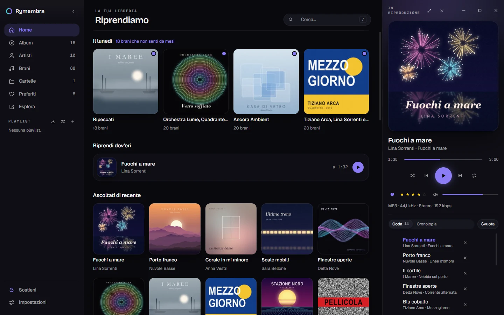
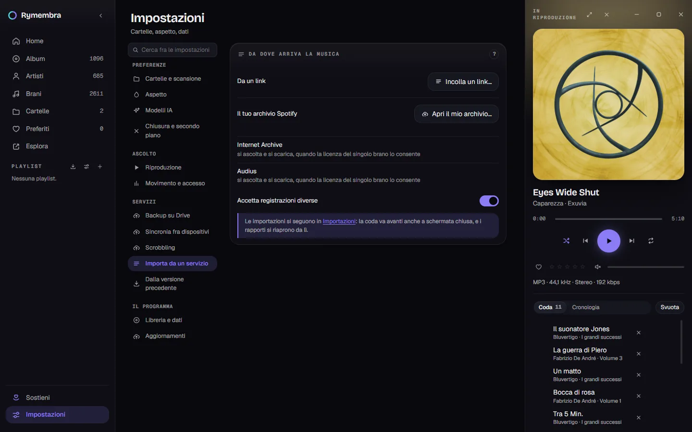
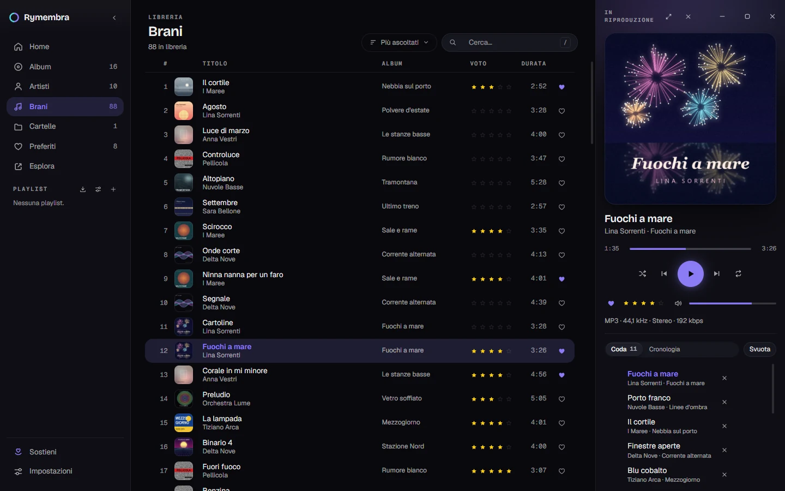
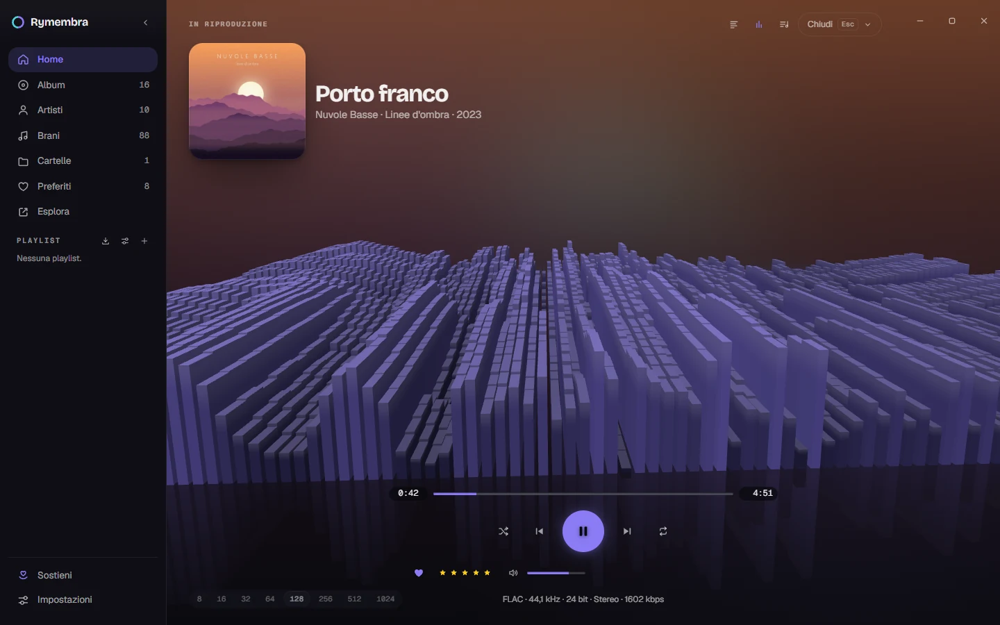
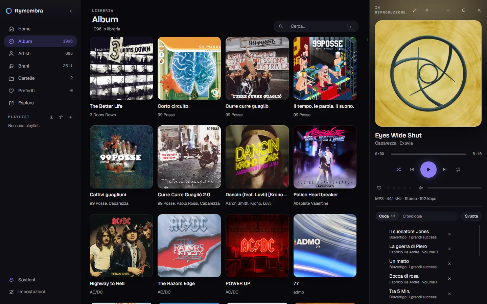
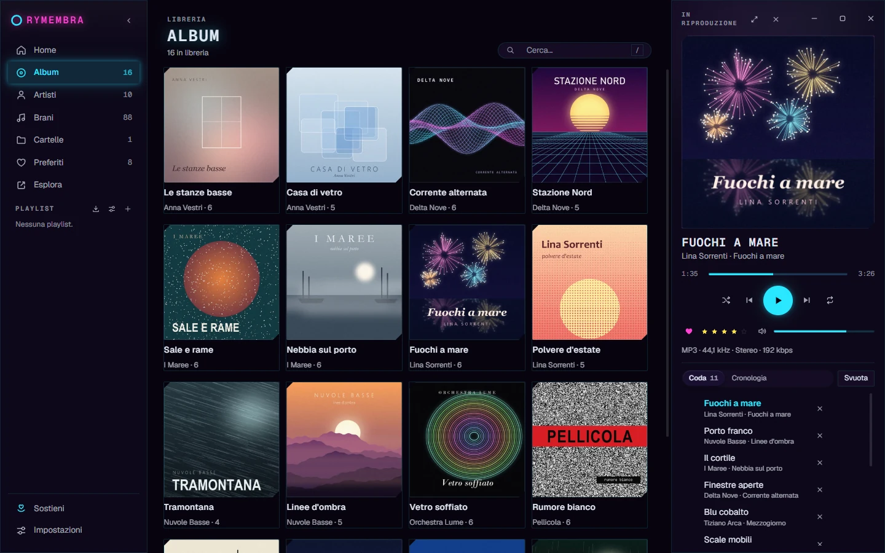
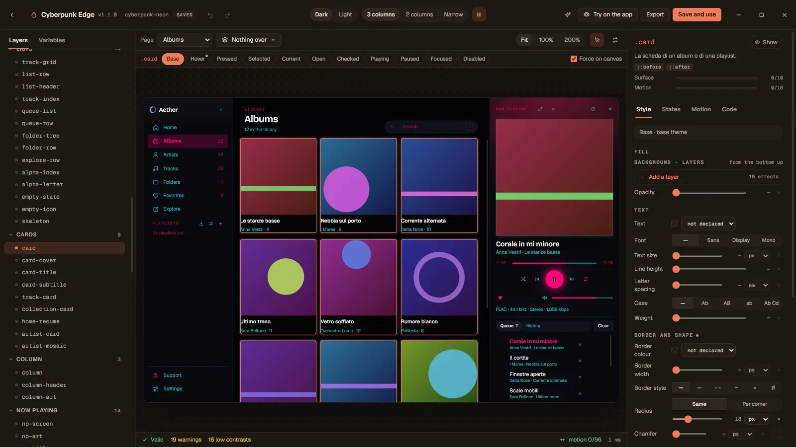

# Rymembra

A music player for Windows and Android, written in Rust. It plays the audio files on your
disk and joins your local library up with the freely accessible music catalogs.

> **Project status:** in use and actively developed. It runs on Windows 10 and
> 11 (64-bit) and on Android 8 or later (64-bit). The Windows installer is not
> digitally signed (the Microsoft Store copy is), and there are no macOS, Linux
> or iOS versions. See [Known limits and planned
> work](#known-limits-and-planned-work).

## Contents

- [Overview](#overview)
- [Where the music comes from](#where-the-music-comes-from)
- [Sources that are excluded](#sources-that-are-excluded)
- [Features](#features)
- [Interface](#interface)
- [Customization](#customization)
- [Installation](#installation)
- [Building](#building)
- [Architecture](#architecture)
- [Licenses](#licenses)
- [Privacy](#privacy)
- [Keeping the project going](#keeping-the-project-going)
- [Known limits and planned work](#known-limits-and-planned-work)
- [Related documents](#related-documents)

---

## Overview

Rymembra plays the audio files already on your disk. Starting from a playlist —
exported from your Spotify archive, read from an M3U file, or given as a link —
it matches the tracks against your local library and fetches the missing ones
from the freely accessible catalogs: Internet Archive and Audius. Since 2.4.0
those catalogs can also be searched directly, a phrase at a time, from
**Explore** — and a track found there can be listened to without ever being
written to disk. Every track it acquires keeps the license of the source it
came from. Tracks that no free catalog has end up in a shopping list, with
links to the shops that pay the artists.

The program does not download content from YouTube, does not scrape Spotify and
does not ship third-party binaries. The reasons are documented in [Sources that
are excluded](#sources-that-are-excluded) and are a project constraint, not a
temporary limitation.



The home screen. At the top, «Il lunedì» (*Monday*): this week's collections,
up to twenty tracks each, worked out on this computer; the dot marks the ones
that are new. Below, «Riprendi dov'eri» (*Resume*) brings back the last
interrupted track at the exact point where it stopped — here *Fuochi a mare*, at
1:32 — and one
click plays it from there. Then «Ascoltati di recente» (*Recently played*);
further down the page, out of the picture, the most recently added albums and
the records you haven't played in six months or more, among those in the
library for at least a month.

On the left, the destinations with their counts — «Cartelle» (*Folders*) counts
the watched folders, not the tracks, and «Esplora» (*Explore*) has no count at
all — and, under «Playlist», the buttons to import a playlist from a file, to
create a smart one and to create an empty one. On the right, the column of what
is playing: cover, title, progress, controls, rating, volume and the line that
says what the file is, with the queue underneath («Coda», 11 tracks here), the
history («Cronologia») and the button that empties the queue («Svuota»). The
same column comes back in most of the pictures that follow.

*The images in this document show the Italian interface — the program speaks
English too, and the Studio picture is taken in English — and come from a
library made up for them: 88 tracks, 16 albums and 10 artists whose names,
covers and sound were invented, so that no picture shows somebody else's
music.*

---

## Where the music comes from

| Source | Content | Local copy |
| --- | --- | --- |
| **Local files** | The main library. Scanning of the folders you point at. | Already yours |
| **Cloud folders** | Your own folders on OneDrive, Google Drive, Dropbox (through an app you register at each, guided step by step in the program) or a WebDAV server (Nextcloud, ownCloud, pCloud, Koofr…), read-only | Only what you play, in a capped cache |
| **Internet Archive** | Live Music Archive (over 250,000 concerts by artists who authorized the recording), netlabels, public domain | Yes, when the item's license allows it; never for an item marked listen-only, nor for a 78 rpm record that declares no license of its own |
| **Audius** | Tracks published by artists under an open license | Yes, when the artist has enabled downloading **and** the license allows it |
| **Spotify GDPR archive** | Playlists, saved tracks and albums, followed artists, complete listening history | Metadata, not audio |
| **Playlist files** | M3U, M3U8, PLS | The path, not the file |
| **MusicBrainz + Cover Art Archive** | Tags and cover art | Free metadata |

On Audius, permission is set by the artist per individual track. There are three
distinct controls: the download switch and two *gates*, which can make access
conditional on following the artist or on holding a token. Rymembra checks all
three and considers permission granted only in the absence of any prohibition.

**Jamendo** is implemented and covered by tests, but disabled in this version.
The cause isn't technical: the API is free for non-commercial use only, and the
terms define commercial use as «any monetary compensation». The module is
already set up for streaming-only listening — the terms forbid caching and
offline access — through `rymembra-net::FlussoHttp`, which plays a track without
writing it to disk. See [Known limits](#known-limits-and-planned-work).



The same sources in the program, under *Settings → Services → Import from a
service* («Servizi → Importa da un servizio»). The «?» in the corner of the card
opens the technical documentation of the section (in English), closed in the
picture. What the rows do:

- **«Da un link»** (*From a link*) takes a track, an album or a collection from
  archive.org or audius.co, with no account and no API key. Rymembra reads what
  is inside, looks in the library for what you already have, and fetches the
  rest when the license allows it.
- **«Il tuo archivio Spotify»** (*Your Spotify archive*) reads, on this
  computer, the ZIP that Spotify hands you on request: playlists, liked tracks,
  saved albums and artists, and years of listening, all at once instead of
  thirty pasted links.
- **Internet Archive** and **Audius** are listed with the rule they follow: a
  track is streamed and downloaded only when its own license allows it.
- **«Accetta registrazioni diverse»** (*Accept different recordings*) lets a
  concert, a reissue or a re-recording by the same artist stand in for the
  studio version, since the free catalogs are mostly made of those — never a
  cover by someone else. When one is taken, the track says so with a «dal
  vivo» (*live*) badge. With the switch off, the search is strict and finds
  much less. Either way a catalog file is taken only when its title and artist
  match the track you want; what matches nothing goes to the shopping list.

The imports themselves run in the «Importazioni» (*Imports*) page: the queue
goes on with the screen closed, and the reports can be opened again from
there.

An import never rewrites a playlist you made yourself. Each import remembers
which playlists it created: importing the same source again rewrites only
those, and when a playlist of yours already has the same name, the imported
one goes beside it — “Chill (Spotify)”, “(Internet Archive)”, “(file)”, or
“(1.0)” for the old database, and likewise “(Drive)” for a Drive restore and
“(.ryprofile)” for a profile — and the plan says so first. Importing the old
database again only lengthens the playlists it brought the time before. A
heart you removed here stays removed when the archive is imported again. When
a playlist at the source loses a track, the import queue drops that track if
it was still waiting, and “Send the history you already have too”, for
scrobbling, sends each listen once even if you press it twice.

### What it doesn't cover

No freely accessible source distributes the commercial catalog. This is not a
technical limitation to be worked around: it is the reason other programs carry
out operations the terms of the services they use do not permit. Rymembra covers
what it can through lawful channels and, for the rest of the catalog, points at
where to buy it. Anyone looking for a tool to obtain commercial discographies
for free will not find that feature in Rymembra. The one exception is opt-in:
the iTunes and Deezer searches used for a second opinion on metadata, whose
terms do not clearly cover a player, are off by default for everyone, and
turning either on is your call (see [`PRIVACY.md`](PRIVACY.md) § 2).

---

## Sources that are excluded

### YouTube

The *YouTube API Developer Policies* forbid downloading and storing audiovisual
content (§ III.E.1.a: «You must not… download, import, backup, cache, or store
copies of YouTube audiovisual content without YouTube's prior written
approval»). There is no configuration that would make the operation compliant.

The same policies also forbid separating the audio from the video (§ III.I.7),
playback from a player that isn't visible (§ III.I.9) and retaining metadata for
more than thirty days (§ III.E.4). A music player that keeps a persistent
library is incompatible with all three clauses. The source is therefore excluded
entirely, and not in a reduced form.

### Unauthorized access to Spotify

Using Spotify's private endpoints, reconstructed tokens or the web player's
client id constitutes unauthorized access to the service and is excluded.

What remains available is the GDPR archive, which Spotify is required to hand to
the user on request under art. 20 of EU Regulation 2016/679, and which contains
a longer listening history than the public API offers.

---

## Features

- **Every track at the same loudness.** Rymembra measures each file with EBU
  R128 — integrated loudness and true peak — in a background pass that runs
  only while nothing is playing and stops, even halfway through a file, when
  the music starts again; it uses ReplayGain or R128 tags where the file has
  them. A network folder that is offline skips only its own tracks, and a
  track on a share too slow to measure in time is marked slow and tried again
  a day later. Track, album or automatic mode; a track is never raised past
  its own peak, and a soft limiter catches the rest. The volume slider follows
  a perceptual curve.
- **Gapless playback**, gapless across sample rates too (a 44.1 kHz album on a
  48 kHz output joins without a click), with an equalizer, crossfade and a
  persistent queue. A single audio engine (`cpal` + `symphonia`) spread over
  three threads, with no shared lock at all between the decoder and the audio
  callback; the stream sleeps after thirty seconds of silence, so the PC can
  go to sleep with Rymembra open.
- **What the file really is.** Next to the rating, a line says what is
  playing — «FLAC · 44.1 kHz · 24-bit · Stereo · 1058 kbps» — as the
  **decoder** reports it while the track plays: the real codec inside an
  `.m4a`, the MP3 that a FLAC page of the Internet Archive actually streams.
  It describes the edition and not the output; if the sound card is
  resampling, the line still says 44.1 kHz, and hovering it says «Resampled
  from 44.1 kHz to 48 kHz for the audio output».
- **A library on SQLite**: incremental scanning with detection of moved files,
  manual and automatic playlists, ratings, favorites and listening history. A
  track can leave it too: «Remove from library» takes the row out and leaves
  the file where it is, «Delete from disk» sends the file to the Recycle Bin —
  or, on a network share or a removable drive (a USB stick, an SD card), where
  there is no Recycle Bin, asks you to confirm a permanent deletion and lists
  the files that would go for good — and both ask first. The drive is the one
  the file is really on, also behind a junction or a folder where a USB stick
  is mounted, and a drive whose type Windows cannot tell counts as one without
  a Recycle Bin. A correction you made by hand
  survives its track disappearing and coming back, and so do its plays,
  rating, heart and playlist places, for ninety days.
- **Music on a NAS or a mapped drive.** A folder the share would not list for
  a moment makes its tracks *unverified*, never *gone*; a scan that would
  remove many tracks shows them and asks first; a drive letter and its
  `\\server\share` path are recognised as the same place.
- **Metadata enrichment** from MusicBrainz, written **into the library and
  never into your files**. The search is carried out on the complete album
  rather than on the individual track; in the absence of matches that are
  reliable enough, nothing is written at all. What it works out is annotated in
  a table of its own, so a correction you made by hand always wins over it and
  forgetting the whole thing is one button — see
  [`PRIVACY.md`](PRIVACY.md) § 8. Tags an older version (2.3.0 or earlier)
  already wrote into your files are left alone: the button that could write
  the old ones back was kept for a while after 2.3.1 and removed in 3.2.0, so
  nothing in Rymembra opens the music files you already had for writing.
- **Folders the way foobar2000 shows them**: a tree read out of the library
  instead of the disk — so it opens instantly and never touches a network
  share — with files as leaves in natural order, a panel with the tracks of
  the folder under the cursor (with or without its subfolders), a filter over
  the whole tree, and multiple selection to play, queue, drag onto the queue
  or add to a playlist.
- **Folders that watch themselves.** An album copied into a music folder,
  renamed or deleted there enters or leaves the library a few seconds later,
  without a scan: only the folders that changed are looked at again, and a
  change that would remove too many tracks at once removes nothing. A folder
  you add — from Settings, by dropping it on the window or from the empty
  Home — is read right away, without pressing «Scan». Network
  shares are watched too, by default: where the share sends notifications
  they are used, plus a realignment at startup, on waking, when the network
  comes back and every 30 minutes; where it cannot, a realignment every five
  minutes. It can be limited to the folders on this computer, or switched
  off, in Settings → Folders and scanning (a NAS that must sleep wants that).
- **Explore**: a free-text search across the Internet Archive and Audius, from
  which a track can be listened to without ever being written to disk. A track
  kept this way lives in the library like any other — it is searchable, it sits
  under its album and its artist, it can be queued, rated and favourited — and
  carries the license it was published under and a link to its public page.
  The search runs when you press Enter, not on every keystroke: on the other
  side are public archives that host the project for free.
- **Synced lyrics** from LRCLIB, with no key and no account, and a way to time
  them yourself when nobody has: you tap once per line, and then — optionally —
  once per word. Rymembra keeps what you timed in its library; switch on «Also
  write synced lyrics to an .lrc next to the track» (Settings › Folders and
  scanning › Lyrics) to also get an `.lrc` beside the track — and, with the
  words, an `.a2.lrc` next to it — that every other player can read. A
  constant drift is corrected with two buttons that are **always** reachable,
  not only when the fit is judged poor: a text that sits inside the right
  duration can still be half a second early.
  When the catalogue holds more than one answer, «Other lyrics» lists them all
  with their first lines, and what you choose stays chosen — «none of these»
  included, which is remembered rather than asked again.
- **Affinity**: what plays after a record ends is chosen from three independent
  layers — the sound of your files, analyzed locally; what you have listened to;
  and the cultural proximity read from ListenBrainz. Each missing layer removes
  itself without breaking the others, and underneath everything the old rule
  cascade remains as a floor. The queue says which layer chose each track.
- **Monday**: up to four collections of twenty tracks, computed on this
  computer when a new week begins and the Home is open, or the first time it
  opens after that, which stay put for
  seven days and then become other ones. A week that came out empty — a new
  library, the analysis still running — is computed again as soon as there is
  something to fill it with, such as the analysis finishing or an imported
  history. The rediscovered tracks leave out what the last four weeks showed;
  the collections by similarity, what last week showed.
- **Skins** that can repaint and animate any part of the window, with a
  built-in visual editor (the Studio) and a packaged distribution format.
  Inside the Studio, a side chat can ask a language model to make the change
  for you — a model running on your own machine (Ollama, or LM Studio's local
  server, the one the Bionic app sits on), a remote one through OpenRouter, or
  any OpenAI-compatible address of your own.
  It is off until you configure a provider, and what it sends is documented in
  [`PRIVACY.md`](PRIVACY.md) § 2-quater.
- **Folders in the cloud.** A music folder on OneDrive, Google Drive, Dropbox
  or a WebDAV server (Nextcloud, ownCloud, pCloud, Koofr, kDrive) joins the
  library next to the folders on the disk, from the same «Add folder» dialog.
  The tracks appear while the service is still listing them, play as a stream
  from the first 256 KB, and changes on the service arrive by themselves —
  within seconds on Dropbox, a minute on OneDrive and Drive. Tags are read in
  the background without downloading whole files; what you play stays in a
  capped cache (200 MB by default) for instant replays, and its loudness is
  measured from there. Read-only everywhere: nothing on the service is ever
  written, moved or deleted. OneDrive, Google Drive and Dropbox are reached
  through an app **you** register with Microsoft, Google and Dropbox —
  Rymembra has none built in — and the program walks you through it, with the
  exact addresses and permissions to type (*Settings → Folders and scanning →
  Your apps*, or straight from the «Add folder» dialog). MEGA is not supported
  yet: it will come, with a MEGA app key of your own, once MEGA's terms are
  cleared. Details of every request in [`PRIVACY.md`](PRIVACY.md) § 4-quater.
- **Backup and synchronization** to Google Drive or to a shared folder, plus a
  **profile** you can carry by hand: a `.ryprofile` archive with the settings,
  the library, the listening history, the lyrics, your corrections, the covers
  and the skin packages in it. It is written and read straight onto the disk,
  one entry at a time, so a profile of several hundred megabytes never sits in
  memory; importing shows you the plan first and proposes a remapping for every
  root that does not exist on this machine, and it only adds: it never deletes
  a playlist, switches off a watched folder, removes a like or clears a
  rating, and in a playlist both libraries have it only appends the tracks
  missing here, without reordering it or changing its rules (a different
  playlist that only shares the name enters beside it). A skin the
  profile would make the one worn passes the same review as an installed
  `.ryskin`, or stays installed but not worn. The old seventeen-line JSON is
  still read, and no longer written. Profiles and skin packages written by the
  previous version can still be imported.

  A restore from Drive shows its plan first, and does not even look for the
  folders on network hosts this PC does not use (it lists them as not
  checked). Restoring before the music is scanned brings back the folders and
  the playlists; the statistics of tracks whose files are not here yet, and
  their places in the playlists, come with a second restore after the scan,
  and the plan says so. The skin you wear is not in the backup: each computer
  keeps its own.

  **Google Drive needs a Google project of your own, and Rymembra has none
  built in — on purpose.** A desktop program cannot keep an OAuth client
  secret: anything compiled into the executable can be read out of it, and a
  shared client would put every user's backups on one quota that anybody
  could exhaust. So *Settings → Backup to Drive* says «not configured» and walks
  you through it, step by step: in the Google Cloud Console, enable the Google
  Drive API, add **both** scopes to the consent screen — `drive.appdata` for
  the backup and `drive.readonly` for the Drive music folders, since one app
  serves both — publish it, and create an OAuth client of the «Desktop app»
  type; then paste its ID and secret into Rymembra. The folder Rymembra writes
  to is its private application folder, visible only to that app: use the same
  app on every PC. If you would rather not, synchronizing through a shared
  folder (Syncthing, OneDrive, Dropbox) needs no account, and an exported
  profile keeps a copy of everything. A client you typed in 3.1 is carried over
  by itself. Backup and sync files that the previous version left in that
  folder are recognised and renamed in place at the next pass, without
  uploading them again.
- **Listen together** on your own network. One device hosts — a PC or a
  phone — and colleagues or family with Rymembra on the same network follow,
  and everybody hears the same track at the same moment — close enough for
  two sets of speakers in one room — while the host's music plays from the
  host's disk, with no server in between. A member who already has an
  identical copy of a track plays it from their own disk instead. Each time
  someone joins, the host chooses whether they just listen, take the controls
  (pause, skip, seek), or can also change the queue and add their own tracks;
  volume, equalizer, output and latency stay each person's own. The first
  time two devices meet, the one asked to pair shows a row with “Show the
  code” and “No”, and only after “Show the code” do both screens show the same
  four-digit code; after that everything travels encrypted, and only between
  devices you paired.
  Devices linked with a QR code (below) are paired already, and can listen together
  away from home too: a linked device that hosts shows up as «via internet».
  Off by default; what it sends is documented in [`PRIVACY.md`](PRIVACY.md)
  § 4-ter, and the firewall question Windows asks the hosting PC is explained
  before it appears.
- **Your music away from home.** Show a QR code on the PC, scan it with the
  phone, and the two find each other on their own — on the same Wi-Fi or across
  the internet, directly or through a relay that sees only encrypted bytes,
  with no Rymembra server. Before linking, the phone shows the name the PC
  gives itself and a short fingerprint of its key, to compare with the one
  next to the QR code. «Browse <device>» opens the other library — albums,
  artists, tracks, search — to play its tracks here, streamed, or to download
  them («Download here»); a listen counts on the device that owns the track,
  which scrobbles it. On mobile data the phone asks first. Off by default; what
  it sends is in [`PRIVACY.md`](PRIVACY.md) § 4-quinquies.
- **Scrobbling** to Last.fm and ListenBrainz.
- **Automatic updates**: a check for releases on GitHub at every start, ten
  seconds after the window is ready, then every thirty minutes; without a
  network it tries again after one, five and fifteen minutes. Installing always
  requires an explicit confirmation, and the installer's signature — bound to
  the version it announces — is verified before it runs. The feature can be
  switched off in the settings; the traffic it generates is documented in
  [`PRIVACY.md`](PRIVACY.md) § 6. The Microsoft Store package doesn't have it:
  there the Store does the updating.

---

## Interface

On a computer’s first run a guided tour runs once, in fourteen steps — the
context menu of a track, the Folders view and the keyboard shortcuts among
them. It is not a
carousel of pictures: each step finds the real element in the window, cuts a
hole in the veil over it and puts the bubble beside it, so what you are shown
is the program at the size and in the skin you are running it in. To show the
player it puts something in the queue, and when it ends the view and the queue
are put back as they were. A step whose element is not there is skipped rather
than faked. “Run the tour again”, in *Settings → Appearance → Guided tour*,
brings it back.



The track list, «Brani» (*Tracks*): cover, title and artists, album, rating,
duration and the heart of the favorites, here in «Per scaffale» order (*Shelf
order*), with the search field beside it — `/` or `Ctrl+F` jumps to it. There
are no pages, numbered or endless: the scrollbar is as long as the whole list
from the first moment, only the rows on screen are fetched — dragging to the
bottom of fifty thousand tracks asks for the last rows and nothing in between —
and a view you leave keeps its scroll position, focus and selection for when you
come back. «Select all» selects the whole view, not what happens to be loaded.



The playback screen, «In riproduzione» (*Now playing*), with the spectrum scene
on — here *Porto franco*, a 24-bit FLAC. The scene is a
grid of bars: from 8 to 1024 across — the row of numbers at the bottom left
chooses how many, 128 here — and about fifty rows in depth. The front row is
now; the rows behind are the last half minute of music, moving back toward the
horizon and fading, with the reflection underneath. The camera sways with the
energy of the low bands, so when the music stops it stops too.

The samples are taken after the equalizer and before the volume control:
changes to the equalization curve are visible in the bars, changes to the
volume are not. The bands reach the interface through a ring buffer that
discards excess samples when it is full, so as not to introduce any wait in
the audio callback. At the bottom right, the line that says what the file is:
«FLAC · 44,1 kHz · 24 bit · Stereo · 1602 kbps». The three buttons at the top
right switch the lyrics, the spectrum and the queue on and off; «Chiudi»
(*Close*), or Esc, closes the screen.

The whole window zooms, `Ctrl++`, `Ctrl+-` and `Ctrl+0`, over the same seven
steps between 90% and 200% that every browser offers. It is the WebView's zoom
and not a scale in the stylesheet, so the two places that measure the DOM — the
virtualized list and the tour's spotlight — go on working in CSS pixels and
never notice. The step is remembered; it does not travel in a profile, because
it is the correction left over after Windows' own scaling on this monitor.

Replacing or clearing the queue and deleting a playlist leave a notice with
«Undo» for ten seconds; the countdown stops while the notice has the keyboard
focus or the pointer over it, and `Ctrl+Z` takes back the last one wherever the
focus is, except inside a text field, where it stays the field's own undo (the
key can be changed in *Settings → Keyboard shortcuts*). Deleting a playlist
also asks first. With a dialog open, the window's × closes the dialog first,
as Esc does.

In the lists, Space selects the focused row and Shift+↑/↓ extends the
selection, as in the Folders tree. A row of the queue or of a playlist you
made can be moved without dragging it: its menu (the right click on the
computer, the ⋮ on the phone) has “Move up”, “Move down” and “Move to top” —
in the queue, the top means right after the track playing.

A smart playlist holds at most 5,000 tracks; its editor counts how many
match the rules, also beyond that, and says how many get in. A track with no
value — no year, no rating, no duration — never satisfies a numeric
comparison, “not equal” included: a rule on a year before 1980 no longer
takes in every track without a year. To find those, there is “is missing”.

---

## Customization

| «Plain» skin, the default | «Neon» skin, built in |
| --- | --- |
|  |  |

The same album grid with two of the skins that come with the program. «Plain»
lays the covers on near black with a single violet accent; «Neon» turns the
accent cyan and makes the current entry glow, writes the name in magenta and the
titles in spaced capitals, and squares the cards off with a thin border. Only
the skin changes between the two pictures: the library, the layout and the track
in the column are the same.

A skin redefines colors, borders, shadows, type and corner radii across 101
interface components — and, since 2.3.0, the visualizer's scene as well: not
only its colors, but its geometry and its behavior, from the depth of the room
and the aperture of the lens down to how fast a bar falls. This is not a matter
of switching between a light theme and a dark one — although a skin has both: it
declares its base scheme, dark or light, and a variant for the other one that
may override its tokens, palette, patterns and components. A skin can also ship
its own fonts and images.

Since 3.0 a skin can **animate any component**. A component binds named
animations to fifteen triggers: its ten states — hover, pressed, selected,
current, open, checked, playing, paused, focus, disabled — and five moments
that are not states: entering, leaving, flying from one screen to the next,
being scrolled into view, changing content. Keyframes move, scale, rotate,
skew, blur, recolor and clip. The line that decides what belongs there is that
a skin animates **states of the DOM, not events of the application**. An
endless loop is allowed only on a state — a record turning while music plays —
because the compiler writes the rules that stop it under «reduced motion» for
every animation it emits, and a skin cannot opt out. Every duration passes
through `calc(… * var(--motion-scale))`, and a test asserts that none escapes.
Instead of fixed caps, each component and the whole window have a cost budget:
going over it is a warning, shown while you spend it.

Skins written for Rymembra 2 are migrated as they are read and look as they
did — a test compares what they compile to against frozen copies, rule by
rule. Skins written in the new format do not open in Rymembra 2.

One thing a skin cannot redraw: the dialogs that ask for a yes — linking a
device, the «Listen together» code, invitations, the firewall question,
deleting from disk, reviewing or replacing a skin. There a skin's layers,
images and fonts do not apply, the text is in the system font, and only its
colours remain. A skin's images may have at most as many pixels as 4096 ×
4096 — checked when the skin is installed, so a skin already installed with
larger ones keeps working — and its id cannot be a Windows device name
(`con`, `nul`, `com1`…). The frame's measures and every effect's parameters
have bounds too: a clip larger than 64 pixels or a player pushed off the
window is refused at installation, and a part made invisible or clipped shut
is a question of the review before the skin is worn.
Installing a skin — from the file picker or by dropping it on the window —
whose id belongs to a different installed one asks first, showing both; the
replaced skin is kept aside on this computer — the last three versions for
each id, removed with the skin when it is uninstalled — and the notice that
follows offers «Put it back».

Two ways out stay open whatever a skin does to the window. A new skin from a
file, once worn, asks “Keep “name”?”: without an answer, the previous skin
comes back by itself after fifteen seconds, for a window that cannot be read
or does not respond. And holding Shift while Rymembra starts opens the
window with Plain; a notice says so and offers “Put it back”.



The Studio is the built-in editor, laid out as one workspace. In the picture it
has «Neon Edge» open — a skin derived from «Neon» with *Settings → Appearance →
Derive…* — with the album card selected.

- **Top bar.** The skin's name, version and save state, undo and redo, the
  theme being edited (Dark, Light), the window width of the preview (3
  columns, 2 columns, Narrow) and a button that pauses the canvas. On the
  right: the button that opens the assistant's chat (see [Asking instead of
  writing](#asking-instead-of-writing)); «Try on the app», which dresses the
  real window in the draft until you press Esc; «Export», which writes the
  package; and «Save and use», which puts it on.
- **Left.** «Layers», the components grouped by area as they sit in the
  window's layout, each group with its count — with a search (`Ctrl+K`) and
  a filter for all of them, the repainted ones and the animated ones — or
  «Variables»: the 73 tokens, the palette, patterns, easings, fonts and images.
- **Middle.** The **real pages of the application** — the page menu says
  which, «Albums» here — running on a sample library and never on yours.
  Beside it, «Nothing over» chooses what to lay on top of the page: a menu, a
  dialog, the queue, the equalizer. The row below forces any state on the
  selected component (Base, Hover, Pressed, Selected and the rest), and «Force
  on canvas» shows it in the preview. A probe names whatever sits under the
  pointer.
- **Right.** The inspector: «Style», «States», «Motion» and «Code» for the
  selection, with what it costs against its budget — «Surface 0/10», «Motion
  4/16».
- **Status bar.** Whether the skin is valid, its warnings, the number of color
  pairs with a contrast ratio below 4.5:1 (the recommended legibility
  threshold), and the motion budget of the whole window: «Valid · 0 warnings ·
  0 low contrasts · motion 94/96» here. The figure is computed before export,
  so a skin distributed with contrast warnings is the result of a deliberate
  choice.

The drawer at the bottom is closed in the picture: it opens where it is needed —
«open in the timeline» from an animation, the error count, «go to line» from a
problem. It holds a timeline to draw an animation keyframe by keyframe, the
list of problems with «go» and «fix», and the whole document in a code editor
that completes from the format's own vocabulary. A palette generator builds a
legible set of colors from one color or from the cover that is playing.

### Asking instead of writing

The Studio also has a chat, and it works because of three properties the skin
format already had: the vocabulary is **closed and declared** — 73 tokens, 101
components, 12 effects, each with a valid example produced by the real parser —
the source of truth is **text**, edited by path; and validation **never fails**,
answering instead with positioned errors and a «did you mean» for every
misspelled name. Those three are exactly what a language model needs to work on
a document and to correct itself when it gets a name wrong.

There are two modes, switched in the panel's header. In *Proposal*, the model
proposes, you read the values that would change, and you press Apply. In *Agent*, the model applies,
re-reads the validation of the result, and fixes what it broke — at most four
rounds, with a Stop button. Either way the change goes through the same path a
dragged slider does, so Ctrl+Z takes it back; in Agent mode a snapshot is taken
before the first round.

What is selected in the Studio travels with the question, so «make this
rounder» means the component you are looking at, in the state and theme you
are looking at. Models that read images can also be shown the preview —
switched on with «Preview», and showing the sample library only. The
conversation stays next to the draft, on this computer, with the tokens each
turn cost; each answer lists the values it changed, and each value is a link to
the thing it names.

You configure the model in Settings › AI Models. Several named profiles can
coexist; each key lives in the operating system's keychain, never in the library
database, and never passes through the window.

---

## Installation

On a computer, two ways, the same program:

- **the installer**, among the assets of the [latest
  release](https://github.com/FedericoBaratti/Rymembra/releases/latest): an NSIS
  executable, which updates itself;
- **the [Microsoft Store](https://apps.microsoft.com/detail/9NW2F2PW2B91)**,
  signed by Microsoft and updated by the Store. The Store copy keeps a library
  of its own, separate from the installer copy’s
  (`%APPDATA%\io.github.federicobaratti.rymembra.store`, which Windows keeps
  inside the package), because two copies opening the same database would
  damage it. The first time it starts, while its library is still empty, it
  offers once to copy the library of an installer copy on the same PC — the
  original stays as it was — and then closes; the accounts in Windows’
  Credential Manager are shared by the two. See [`PRIVACY.md`](PRIVACY.md) § 6.

On a phone, **the APK**, Android 8 or later, 64-bit (ARM):

- it is among the assets of the same release, as
  `Rymembra_<version>_android-arm64.apk`. Download it on the phone and open
  it: the first time, Android asks you to allow installing apps from the
  browser or the file manager you opened it with;
- every release APK is signed with the same key. Its certificate’s SHA-256
  fingerprint is
  `24:85:94:2C:0F:5D:73:42:97:CD:96:A6:65:19:C7:2E:49:22:C7:05:37:E8:F3:9A:B2:D9:80:60:24:18:2A:C1`
  (also in `strumenti/android-certificato.sha256`); on a computer with the
  Android SDK, `apksigner verify --print-certs <apk>` prints it on the line
  `Signer #1 certificate SHA-256 digest`, with or without the colons;
- after that, Rymembra itself offers the updates, from the same release (see
  [Known limits](#known-limits-and-planned-work) → Android → Updates);
- **a test build**, signed with another key, cannot be updated to the public
  APK: Android refuses to install one over the other, and Rymembra says so
  instead of offering the update. To move to the public version without
  losing your library, export the profile (*Settings › Library and data ›
  “Export the profile…”*), uninstall Rymembra, install the APK and, there,
  “Read a profile…”. Your music files stay where they are; the connected
  accounts and the linked devices have to be connected again, because their
  secrets never leave the phone and the profile does not carry them.

**Windows SmartScreen warning.** The installer is not signed with a code
signing certificate, so SmartScreen blocks it on first launch (the Store copy
is not affected). To proceed: «More
info» → «Run anyway». The reasons for the missing signature are given in [Known
limits](#known-limits-and-planned-work).

**Coming from the previous version.** The installer removes the previous
version by itself, and leaves its data where they are: if that version is
still open it waits a few seconds for it to close (or asks you to close it,
also from the icon next to the clock) before going on. The first time
Rymembra starts, the data of the previous version are transferred
automatically — library, settings, covers, skins, Studio drafts, profile
copies, the log — and the accounts it had saved in the operating system's
keychain and its backup and sync files on Google Drive are picked up on first
use. Nothing is overwritten or deleted: if a library already exists in the new
folder it wins, and if the previous version is still running when Rymembra
starts, Rymembra says so and closes without touching anything.

**Uninstalling.** From Windows' *Settings → Apps*. The library, the settings
and the covers stay unless you tick «Delete the application data» («Cancella i
dati dell'applicazione») in the uninstaller; the tokens of the connected
accounts and the keys that identify the PC stay in Windows' Credential Manager
in any case, because the uninstaller never touches it — disconnect the accounts
in Rymembra first, or delete those entries by hand. The full list is in
[`PRIVACY.md`](PRIVACY.md#when-you-uninstall).

The changes introduced by each version are listed in
[`CHANGELOG.md`](CHANGELOG.md). The numbering rule is described at the top of
that file, and 2.3.1 amended it: the number no longer tries to say how much a
release contains, because that turned out to be a thing two readers score
differently. What it does say is whether a copy that updated and a copy that
did not still understand each other.

Migrations are not reversible, and that warning moved out of the number and
into the text. **Every release that migrates the database names its migrations
in its own entry and says what going back would cost** — which is always the
same thing: a copy of the database taken before the update, because an older
version refuses to open a newer database rather than guessing at it. 2.3.1
migrates twice, `019_identita_e_metadati.sql` and `020_cronologia_unica.sql`,
and it is a patch. From 3.0 Rymembra takes that copy itself before every
migration — `rymembra.db.schema-NNN.bak`, beside the database, the last two
kept. On the computer, “Go back to the copy from before the update”, in
*Settings › Library and data*, puts it back: it sets the current library
aside as `rymembra.db.messa-da-parte.bak`, puts the copy in its place inside
the open database, and closes Rymembra, so that you can install the previous
version. It works even when the library does not open. Going back by hand
means quitting Rymembra, also from its icon next to the clock, moving
`rymembra.db`, `rymembra.db-wal` and `rymembra.db-shm` aside together — the
last two belong to the newer database, and next to the copy SQLite would
read them as its own — and copying the `.bak` to `rymembra.db`, not moving
it, so that the `.bak` stays as a fallback.

---

## Building

### Requirements

- **Rust** — stable, 1.91 or later (`rust-version` in `Cargo.toml`); CI pins
  the exact release in `.github/workflows/verify.yml`
- **Node.js** 24 or later — the interface's TypeScript tests run on Node's
  own type stripping
- **Windows** for the installer; for the APK, the Android SDK and NDK as
  well (see [Known limits](#known-limits-and-planned-work) → Android →
  Builds)

### Commands

```bash
# Most of what CI's main job checks, in one go: versions, translations, CSS
# classes, the docs and the website, the interface's build and tests, the
# release tools' tests, formatting, clippy and about 4,000 Rust tests — all
# runnable with no network connection. The Android build, the dependency
# checks below, the check of the license notices and the checks for bundled
# binaries and forbidden tools run in CI only (.github/workflows/verify.yml)
cd apps/desktop && npm run verify
```

```bash
# The Rust part exactly as CI runs it: the toolchain pinned in verify.yml, with
# warnings as errors and --locked. Install that toolchain once with
# rustup toolchain install <version> --profile minimal --component rustfmt,clippy
cd apps/desktop && npm run verify:ci
```

```bash
# Licenses and security advisories of the Rust dependencies (cargo-deny),
# and of the npm packages that ship inside the window
cargo deny check
cd apps/desktop && npm audit --omit=dev
```

```bash
# Start in development mode
cd apps/desktop
npm install
npm run dev
```

```bash
# Build the NSIS installer. createUpdaterArtifacts is switched off for this
# run, as the release workflow does: with it on, `tauri build` wants to sign
# the update and stops without the private key (see below)
cd apps/desktop
npx tauri build --config '{"bundle":{"createUpdaterArtifacts":false}}'
```

```bash
# Regenerate the third-party license notices
node strumenti/licenze.js
```

```bash
# Build the website (landing page in four languages and the technical
# documentation) from site/ into _site/, and check it; serve _site/ with any
# static server to preview it
node strumenti/sito.js
```

### Updater signing keys

The update system requires a key pair, generated once. The keys are not
versioned: the `.chiavi/` folder is excluded through `.gitignore`.

```bash
cd apps/desktop
npm run tauri signer generate -- -w ../../.chiavi/rymembra.key
```

The contents of the `.pub` file go into `plugins.updater.pubkey` inside
`tauri.conf.json`; the private key goes into the secrets of the GitHub
environment `release` under the name `TAURI_SIGNING_PRIVATE_KEY`, and its
password, if it has one, under `TAURI_SIGNING_PRIVATE_KEY_PASSWORD` — not into
the repository secrets, which any workflow on any branch can read. In
*Settings → Environments → release*, allow only tags `v*` and add a required
reviewer: the `firma` job, the only one that names the environment, then waits
for an approval before it gets the key. A release run by hand starts
from the tag itself (*Use workflow from → Tags*), with the same tag in its
`tag` field; a run from a branch stops at once.

The private key signs the executables that get installed automatically on users'
systems: losing it permanently prevents every existing installation from
updating. The `strumenti/manifesto.js` script compares the identifiers of the
two halves on every release, so that any mismatch surfaces in CI.

Since 3.0 the signature also carries the version it was made for, and the
updater refuses an update whose signature does not match the version the
manifest announces (`requireSignedVersion`). The release workflow signs on a
machine of its own, after the build, with
`npx tauri signer sign --app-version <version> <installer>`; signing by hand
without `--app-version` produces an update no 3.x copy will install, and
`manifesto.js` stops before publishing it.

---

## Architecture

```
core/
  rymembra-domain     pure logic: no I/O, no access to the clock,
                      no global state
  rymembra-play       audio engine (cpal + symphonia)
  rymembra-app        the library: SQLite, scanning, imports, queue
  rymembra-catalogo   the free-access catalogs; the only module that
                      downloads audio
  rymembra-net        blocking HTTP (ureq), rate limiting, circuit breaker
  rymembra-meta       MusicBrainz, Cover Art Archive, Deezer, iTunes
  rymembra-archivio   reading the Spotify GDPR archive
  rymembra-skin       the skin format and its compiler
  rymembra-oauth      PKCE and the system keychain
  rymembra-cloud      Google Drive backup; the cloud folders (OneDrive,
                      Google Drive, Dropbox, WebDAV): listing, changes,
                      streaming, the cache
  rymembra-sync       synchronization between devices
  rymembra-scrobble   Last.fm and ListenBrainz
  rymembra-ia         an OpenAI-compatible client for language models,
                      which knows nothing about skins
  rymembra-insieme    «Listen together»: discovery, the Noise channel,
                      pairing, reading tracks across the LAN; it knows
                      nothing about the player
  rymembra-lontano    your devices over the internet: the QR link, the
                      protocol, an iroh (QUIC) endpoint behind a blocking
                      façade; it knows nothing about the library
apps/desktop          the interface: Tauri 2 + React 19
```

The direction of the dependencies is binding. `rymembra-catalogo` has no access to
`rusqlite`: it is therefore structurally impossible, and not merely inadvisable,
to hold the library lock for the whole duration of a download.

How every part works — threads and locks, the schema, the scan, the audio
engine, the skin compiler, the IPC surface — is described in the [technical
documentation](https://federicobaratti.github.io/Rymembra/docs/), whose source is
in `site/docs/`.

---

## Licenses

Rymembra's code is distributed under the **MIT** license
([`LICENSE`](LICENSE)).

The dependencies use different licenses: the `symphonia` family is **MPL-2.0**,
`cpal` is **Apache-2.0**. The complete list with the full texts is in
[`THIRD-PARTY-NOTICES.md`](THIRD-PARTY-NOTICES.md), regenerable with the script
given in [Building](#building). The Geist and Bricolage Grotesque fonts are
distributed under **SIL OFL 1.1** (`apps/desktop/src/font/OFL.txt`). The APK
carries copies of `LICENSE`, `THIRD-PARTY-NOTICES.md`, `PRIVACY.md`,
`TERMS.md` and the fonts’ license in `assets/legale/`.

The music in `site/audio/` — the website’s soundtrack, `machina.mp3`, which
two Rust tests also play, and the twelve seconds of it in the site’s sound
demo, `passaggio.mp3` — is [“Machina”](https://www.scottbuckley.com.au/library/machina/)
by Scott Buckley, licensed under
[CC BY 4.0](https://creativecommons.org/licenses/by/4.0/); recompressed for
the site, and for the demo cut and with its volume changed.

The music acquired through Rymembra is subject to the license of the source it
came from, which is distinct from the program's. The implications are described
in [`TERMS.md`](TERMS.md), including the Live Music Archive's **non-commercial**
clause, which binds the listener too.

---

## Privacy

Rymembra collects no telemetry, requires no account and talks to no servers other
than these: GitHub, to check for updates; MusicBrainz and the Cover Art
Archive, for metadata and cover art, and ListenBrainz, for similarity — on by
default, each with a switch; iTunes and Deezer, only if you switch them on
(they are off by default, because their terms do not clearly cover this use);
LRCLIB for lyrics, only while the
lyrics panel is open or when you fill the library; the music catalogs, when you
search or import; and, only if you connect them, Google Drive, the cloud
services whose folders you add, the scrobbling service and the language model
configured for the Skin Studio — the last one possibly not a server at all,
since Ollama and LM Studio run on your own machine.
«Listen together», if you switch it on, talks only to other Rymembra on your
own network, encrypted, and shares music only with the devices you paired.
Linking your devices over the internet, if you switch it on, is the one
feature that reaches beyond your network and your accounts: your devices find
each other through n0's public DNS and the BitTorrent DHT, and talk directly
or through a public relay (n0's, or one you run) that sees only encrypted
bytes; they share music only with the devices you linked with a QR code. A
«Listen together» session between two linked devices away from home travels
inside that same link, encrypted twice.

[`PRIVACY.md`](PRIVACY.md) lists every single network request the program can
make and the data each one transmits, and what the system’s own browser
engine, which draws the window, collects by itself.

---

## Keeping the project going

Rymembra is free and funded by donations. There is no paid version and none is
planned: two of the integrated sources, the Live Music Archive and Jamendo, are
subject to *non commercial* clauses that a paid version would violate. The
constraint is stated explicitly in the terms of use.

---

## Known limits and planned work

- **Code signing for Windows.** Without a certificate, SmartScreen blocks the
  installer, which is the main reason independent applications fail to get
  installed. An OV certificate requires validation of the applicant's identity
  and an annual cost.
- **Jamendo.** The code is there and the tests pass
  (`cargo test -p rymembra-catalogo --features jamendo`), but the feature is
  disabled pending formal clarification from `licensing@jamendo.com` on whether
  donations count as commercial use.
- **Seeking inside a streamed track.** Dragging the cursor through a streamed
  track is not instant, and on a large MP3 it can take tens of seconds. The
  cause is not Rymembra: an MP3 without a seek table cannot be positioned by
  arithmetic, so the decoder *scans* to the point — and scanning means asking
  the network for every byte in between. 2.4.0 removed what could be removed
  (the window grows while reading forward, and the Archive's storage node is
  resolved once per track rather than once per request), and what remains is the
  download of the bytes being skipped. While it lasts the cursor says so, which
  is the part that was actually broken: before, the window said «playing» with
  the position frozen. FLAC and WAV are unaffected — they carry a seek table, or
  the offset is a multiplication.
- **Listen together and Bluetooth.** A Bluetooth output plays the sound later
  than Windows says, by an amount no driver reports and Rymembra cannot
  measure. Two people each wearing their own headphones do not notice; speakers
  and Bluetooth headphones in the same room do, and are aligned by ear with
  «Calibrate», once per output. The same goes for a Bluetooth output whose
  delay changes by itself after a reconnection.
- **Listen together over Wi-Fi.** A member's own tracks reach the others
  through the host, so on Wi-Fi the host carries each of them twice. The
  session state (the queue, up to a thousand voices) travels compressed, about
  a fifth of its size, and at most once a second while the host is still
  describing a new queue. A network where devices cannot see each other (guest
  networks, «client isolation») cannot be used at all: nothing reaches the
  host. On a very slow or congested link (around 5 Mbit/s with tens of
  milliseconds of jitter) a member may take a while to estimate the host's
  clock before it starts, and after thirty seconds with every exchange too
  slow it says “The network is too slow to follow the session”. When the host
  changes track and the new one is slow to open on a member (a long variable
  bitrate MP3 over the network, for instance), the member keeps playing the
  previous track until the new one is ready.
- **Cloud folders.** Each service is reached through an app you register
  yourself, and two of the registrations have a catch. Microsoft no longer lets
  a personal account register an app outside a directory: OneDrive needs a
  Microsoft Entra tenant, which in practice means a free Azure account
  (Microsoft usually asks for a card to verify it) or a work or school account
  whose administrator allows registering apps. Google shows «Google hasn't
  verified this app» for your own app — you go on through «Advanced», since it
  is yours — and an app left in «Testing» makes the connection expire every
  seven days, so publish it. OneDrive for Business and Google shared drives are
  not supported (folders shared with your Google account are, under «Shared
  with me»); a shortcut inside a chosen Drive folder is not followed; a `.lrc`
  next to a cloud track is not read; MEGA is not supported yet. A CD image stored
  as one MP3 with its `.cue` in a cloud folder plays with estimated track
  boundaries: exact at a constant bitrate, off by up to seconds at a variable
  one, because an exact seek would re-read the file from the start over the
  network. A cloud folder removed from the library takes its listing with it:
  its tracks stay in the library but do not open until you choose the folder
  again. On a WebDAV server whose symbolic links loop back to a parent folder,
  listing stops at 32 levels of subfolders — the copies down to that depth
  come in as duplicate paths — and the log says so at each full re-listing,
  every half hour.
- **Your devices over the internet.** It needs no server of Rymembra's, and
  so it leans on public ones: n0's relays and DNS are free, rate-limited and
  without guarantees, and when both devices sit behind a carrier's NAT — two
  phones on mobile data, often — every byte goes through a relay, slower than
  a direct path. n0 offers its public relays for development and hobby use,
  and supports on them only the latest stable release of iroh: a copy of
  Rymembra left without updates can one day lose the relay, and with it the
  link away from home. A relay of your own (`iroh-relay`) does not depend on
  that. A phone is reachable only while Rymembra is on screen or
  playing, and for two minutes after. Only tracks in local and network
  folders are shared, not cloud folders or catalog tracks; a track of a CD
  image (one file with its `.cue`) plays but is not downloaded. Seeking in a
  remote track is approximate, as in any streamed track. «Listen together»
  away from home is as good as the path: the host sends each track to each
  member, so through a relay — or from a phone on mobile data — a session of
  several members can stall, and over a jittery link the members stay in
  step less tightly than at home (clock samples are kept up to a 400 ms round
  trip instead of 100 ms).
- **The window’s engine on Windows.** WebView2 sends Microsoft its required
  diagnostic data, and a minidump when one of its processes crashes, which
  can hold the titles on screen. Turning the minidumps off needs an option of
  the WebView2 environment that Tauri does not expose yet; see
  [`PRIVACY.md`](PRIVACY.md) § 6-bis.
- **Sorting by title.** The Albums and Artists grids sort ignoring accents and
  a leading article (“The Beatles” under B, “Édith Piaf” under E); the Tracks
  list sorted by title or by shelf still puts accented initials after Z,
  because doing it there at the same speed needs a new indexed column in the
  database, which is planned.
- **Proxies.** Rymembra follows the proxy set in Windows Settings
  (`ProxyEnable`, `ProxyServer`, `ProxyOverride`); names without a dot — a
  NAS, a computer at home — and this computer itself always go direct. It does
  not read a setup script (PAC) or automatic detection (WPAD): with only
  those, it connects directly. `ProxyServer` is read only in the `host:port`
  form, and one written per protocol (`http=…;https=…`) goes direct too. The
  `HTTPS_PROXY`-style environment variables win over the Windows setting, and
  a proxy changed while Rymembra is open is picked up only by what starts
  afterwards: restart Rymembra to be sure every request uses it. (The update
  check goes through a client of its own, which reads the Windows setting by
  itself.)
- **macOS, Linux and iOS** are not supported: the computer version is built
  only for Windows (the installer is NSIS, the Store package MSIX), the phone
  version only for Android.
- **Android.** The same application, built from the same code: the core is
  shared, and the window becomes an interface of its own — four tabs (Home,
  Library, Search, More), a mini player, menus as sheets from the bottom,
  «Now playing» full screen, a long press for multiple selection. The
  colours and fonts are the active skin's. What only a computer has is not
  there: the tray icon, the taskbar buttons, the window zoom, the keyboard
  shortcuts, the 3D spectrum and the Skin Studio (skins can still be chosen,
  installed and removed, not edited). Specific limits:
  - **Builds** need the Android SDK and NDK and, on Windows, *Developer Mode*
    (the Tauri CLI links the native library into the Gradle project with a
    symbolic link). Without it, let `tauri android build` compile the library
    and stop at the link, copy `target/<triple>/debug/librymembra_lib.so`
    into `gen/android/app/src/main/jniLibs/<abi>/`, and run
    `gradlew assemble<Arch>Debug -x rustBuild<Arch>Debug`. Only 64-bit
    devices (`arm64-v8a`) and the `x86_64` emulator are built: AAudio, the
    audio output, needs Android 8.
  - **Updates** are checked on GitHub, every six hours while the app is
    running (on the computer, every thirty minutes), and the APK for the
    phone's architecture is downloaded by Rymembra, only from an asset of the
    project's GitHub release, and only if the release carries its minisign
    signature too (`<apk>.sig`). Before Android's installer sees it, Rymembra
    checks that signature with the same key as the computer’s updater, for
    the version announced, then that it is this same app signed with the same
    certificate as the installed one; if not, it deletes it and says so. A
    copy signed with another key — a test build — is not offered the update
    at all (see [Installation](#installation)). Installing it is then up
    to Android, which asks the person using the phone to confirm every time —
    and, the first time, to allow Rymembra to install apps. It is never silent.
  - **The screen** stays upright: the phone interface is locked to portrait
    in this version. The guided tour of the computer is not offered on the
    phone.
  - **TalkBack** reads the app, but cannot offer custom actions on a row: a
    page drawn in Android’s WebView has no way to add them. Moving a row of
    the queue or of a playlist is in the row’s ⋮ menu (“Move up”, “Move
    down”, “Move to top”).
  - **Deleting a track from disk** sends it to Android's trash, from which the
    Files app restores it for 30 days, after Android's own confirmation. That
    trash exists from Android 11 and only for files Android's media index
    knows: on Android 8–10, and for a `.cue` or a file in a folder with
    `.nomedia`, deleting is permanent, and the confirmation says so.
  - **Android Auto** shows Rymembra's library — recent, playlists, albums and
    artists, with covers, the queue, search, like, shuffle and repeat. Two
    limits come from Android, not from Rymembra. An app installed outside the
    Play Store appears in the car only after *Android Auto → developer
    settings → Unknown sources* is switched on. And Android does not let an
    app open itself from the background: if Rymembra is not running at all,
    the car says «Open Rymembra on your phone» with a button that opens it,
    and the library appears as soon as it has started once. Only trusted
    controllers reach the music session — Android Auto is recognised by its
    package and Google's certificate — and that check has yet to be tried
    with Android Auto on a real phone (with Google's Desktop Head Unit): if
    the car stops showing Rymembra, it is the first thing to look at.
  - **Connecting a service** (Google Drive, OneDrive, Dropbox, Last.fm)
    opens its consent page in the phone's browser, which comes back to
    Rymembra through a local address while Rymembra waits behind it. If
    Android closes Rymembra in the meantime — little memory, a long detour
    through other apps — the consent is lost and has to be started again.
  - **Listen together** needs, from Android 17, the «Nearby devices»
    permission: without it Android keeps the home network away from the app.
    Rymembra asks for it when the function is turned on. The audio output is
    always the one Android chooses — speaker, cable, Bluetooth — and changes
    from Android's own output picker, not from Rymembra's settings.
  - **The TLS roots** are the Mozilla list compiled into the app
    (`webpki-roots`) and not the system's: a certificate installed by hand on
    the phone is not trusted.
  - **Signing**: the release APK is built without a key and signed by the
    release workflow, in the protected `release` environment; it must carry
    the certificate whose fingerprint is in
    `strumenti/android-certificato.sha256`, and losing that key means no
    later APK can be installed over the copies already out. A build of your
    own needs a keystore of your own (see
    `apps/desktop/src-tauri/gen/android/keystore.properties`, not versioned),
    and Android then refuses to install the public APK over it, or it over
    the public one.

One question still has no written answer: whether **donations** constitute
commercial use for the purposes of Jamendo’s terms (`licensing@jamendo.com`)
and of the Deezer API. Until there is one, the Jamendo module stays behind a
Cargo feature that is off in the builds, and Deezer, like iTunes, is off by
default and turned on only by whoever uses it.

---

## Related documents

| Document | Content |
| --- | --- |
| [Technical documentation](https://federicobaratti.github.io/Rymembra/docs/) | How the code works, subsystem by subsystem (`site/docs/`) |
| [`CHANGELOG.md`](CHANGELOG.md) | The changes in each version and the numbering rule |
| [`PRIVACY.md`](PRIVACY.md) | How data is handled and every network request |
| [`TERMS.md`](TERMS.md) | Terms of use and the licenses of acquired content |
| [`SECURITY.md`](SECURITY.md) | How to report a vulnerability |
| [`THIRD-PARTY-NOTICES.md`](THIRD-PARTY-NOTICES.md) | The dependencies' licenses |
